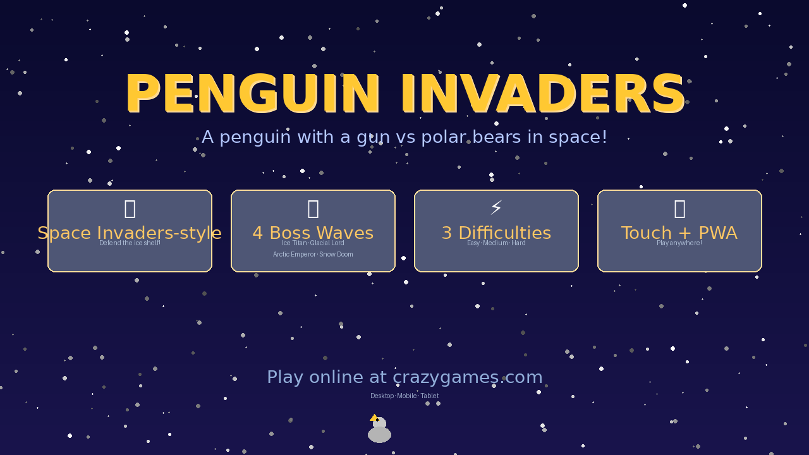
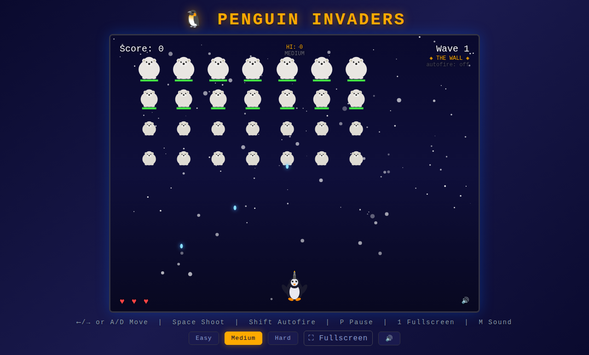
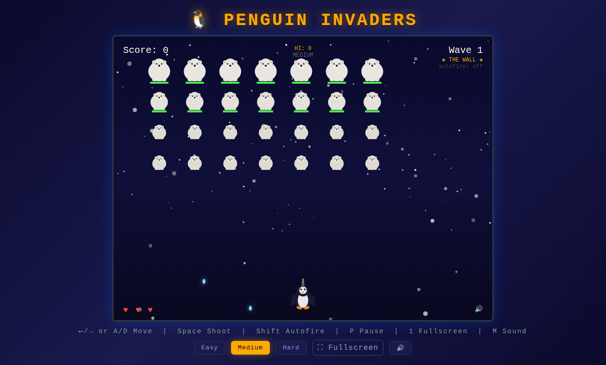

# 🐧 Penguin Invaders

A Space Invaders–style arcade shooter. You're a penguin defending the ice shelf from waves of invading polar bears — with chiptune music, boss fights, power-ups and a combo system.



## Play

**[▶ Play in your browser](https://oscarthewhitehathacker.github.io/penguin-invaders/)** — or just open `index.html` locally. No build step, no dependencies.

```bash
git clone https://github.com/OscarTheWhiteHatHacker/penguin-invaders.git
cd penguin-invaders
# open index.html in a browser, or serve it:
python3 -m http.server 8000
```

It's also installable as a PWA (offline play via service worker).

## Screenshots

| Gameplay | Action |
| --- | --- |
|  |  |

## Controls

| Action | Keyboard | Touch |
| --- | --- | --- |
| Move | ← / → or A / D | Drag on screen |
| Shoot | Space | Tap |
| Autofire | Shift (hold) | — |
| Pause | P | Pause button |
| Fullscreen | 1 | Fullscreen button |
| Mute / unmute | M | Sound button |

## Features

- **7 wave patterns** — THE WALL, V FORMATION, DIAMOND, PINCER, SWARM, TANKS, ARROWHEAD
- **3 difficulty levels** — Easy (5 lives), Medium (3), Hard (2, tougher bears)
- **Boss waves every 5 waves** — giant crowned bear with red eyes and an HP bar
- **Power-ups** dropped by killed enemies — Spread Shot, Rapid Fire, Shield, 1UP, Nuke
- **Combo system** — consecutive kills build a score multiplier up to 4×
- **High score** persisted in `localStorage`, with a celebration on a new record
- **Arcade chiptune** generated with the Web Audio API (melody + bass + drums)
- **Juice** — screen shake, particles, snowflakes, twinkling stars, score popups, wave banners
- **Pause overlay**, fullscreen support, and touch controls

## Project layout

Everything is flat at the repo root so the game runs from `file://` and from static hosts (e.g. CrazyGames) with relative paths:

```
index.html            # the whole game (markup, CSS, JS)
manifest.json         # PWA manifest
service-worker.js     # offline caching
icon-192x192.png      # app icons
icon-512x512.png
cover.png             # cover art
screenshot-gameplay.png
screenshot-action.png
new_background_music.mp3
IDEA.md               # original design notes
penguin-invaders.zip  # packaged build for submission
```

## Tech

Plain HTML5 Canvas + vanilla JavaScript. No frameworks, no bundler, no dependencies — one 2,600-line `index.html`.

## License

MIT
